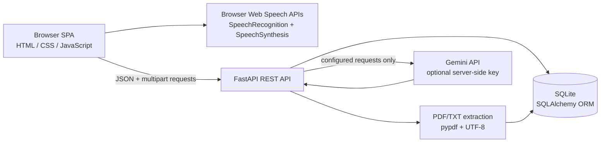

# System architecture

The browser app and API are served by the same FastAPI process. Persistent sales records and settings use SQLite. Documents are extracted to text and indexed in the database; retrieval currently uses keyword matching. Live speech recognition and synthesis run in the browser and depend on browser support and microphone permission. Gemini credentials are read from server environment variables and are never returned by the API.

